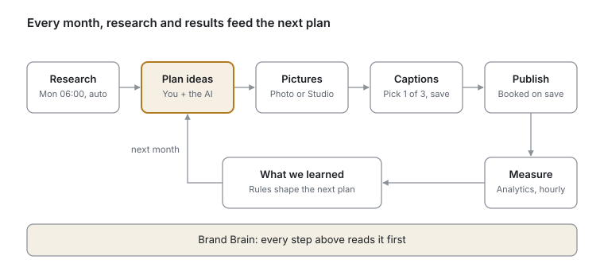

# Start here

The app runs one monthly loop: it learns the brand, researches the market, plans the posts, makes the pictures and captions, publishes them, and measures what worked. This part shows that loop; each part after it explains one area of the app.

## The main cycle

Research and the learned rules feed each new plan; the plan becomes pictures, captions and booked posts; their results become next month's rules. The Brand Brain sits under all of it.

## The cycle, step by step

You do six things a month; the app does the rest. Each step names its page in the sidebar and the part of this guide that explains it.

1. **Keep the Brand Brain up to date** (Brand Brain). Everything the AI writes or draws reads it first: who we are, the tone, products, photos, rules. Update it when something about the company changes. *See part 1 · Brand Brain.*
2. **Read the research** (Research). Every Monday at 06:00 (KSA) the research agent reads the market: leads and tenders, competitors, events, news, our website and our channels. It writes a report with priorities and content ideas. You can also press Run research at any time. *See part 2 · Research.*
3. **Plan the month** (Content Planning). Pick the month, add the posts you already know you want, and let the AI suggest more. It uses the Brand Brain, the latest research, past posts and the learned rules. Approve or reject each idea. *See part 3 · Content Planning.*
4. **Give each post a picture** (Content Planning, then Creative Studio if needed). Pick a photo from the Brand Brain, upload one, or make one in the Creative Studio. *See part 4 · Creative Studio and Media Library.*
5. **Pick the captions and save** (Content Planning). The AI writes three captions from each picture; you pick one and check the date and time. Saving the plan books every post automatically on Instagram and LinkedIn. There is no second approval step. *See part 5 · Publishing and Social.*
6. **Check the queue and the numbers** (Post Queue, Schedule, Analytics). The Post Queue shows anything that failed or still needs a time. Analytics shows how posts did. *See part 6 · Analytics.*

**Then the loop closes.** The app records which ideas you approved, rejected or rewrote, and how published posts performed. Under Research → What we learned it proposes short rules (for example, "do not open captions with a question"). Once you approve a rule, it shapes every plan and caption that follows.

## Where everything is

Every page in the sidebar, in sidebar order. Leads, Targets and Agent Brief are for the sales team and admins and are not covered here.

| Sidebar page | What it is for | Explained in |
| --- | --- | --- |
| Dashboard | Today's numbers, posts that need you, and the latest research | 8 · Dashboard, Assistant and Settings |
| Brand Brain | Everything the AI knows about the company | 1 · Brand Brain |
| Creative Studio | Make and edit pictures, videos and reels with AI | 4 · Creative Studio and Media Library |
| Content Planning | Plan a month of posts: ideas, pictures, captions | 3 · Content Planning |
| Schedule | The calendar of booked posts; drag to move them | 5 · Publishing and Social |
| Email Flows | Newsletters, outreach emails, contacts and groups | 7 · Email Flows |
| Social Media | Connect accounts; one page per platform with its posts and numbers | 5 · Publishing and Social |
| Post Queue | Every post: what needs you, what is next, what went out | 5 · Publishing and Social |
| Auto-replies | Automatic replies when someone comments a chosen word on Instagram | 5 · Publishing and Social |
| Analytics | How each account and post did, the website, and a printable report | 6 · Analytics |
| Assistant | Ask questions about this brand's data in plain words | 8 · Dashboard, Assistant and Settings |
| Research | The weekly market report and What we learned | 2 · Research |
| Media Library | Every image, video and document in the company | 4 · Creative Studio and Media Library |
| Settings | Add, rename, switch or delete companies | 8 · Dashboard, Assistant and Settings |
| Team & Access | Who can sign in and which companies they see | 8 · Dashboard, Assistant and Settings |

**One rule for every page:** the app works per company. The company name at the top of the sidebar decides whose Brand Brain, posts and numbers you see. Switch it there.
